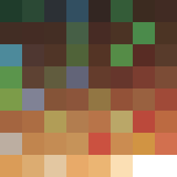

# Strange Ranger: Art Request 01

From the lab, 15 November 2026. Everything the game still needs as pictures for phase one, plus two things to confirm. Make the sheets, drop them in `C:\gamelab\stardew-longdark-hybrid\ref\`, tell the lab, and it will clean them, check them, and put them in the game.

## How to make each sheet

These rules come from what went right and wrong with the first batch.

- **One picture per cell, in the grid shown.** Square cells, evenly spaced, with clear space between items.
- **Nothing crosses a cell edge.** A tree branch or a flame poking into the next cell fails the check.
- **Each item is one connected piece.** The first campfire failed because its flames floated apart from the stones. Small parts must touch the main shape.
- **Transparent background**, or one flat plain colour. Avoid glows, shadows on the background, or gradients: the trees sheet's dark glow was hard to remove.
- **Same look as your first sheets**: cozy 16-bit top-down pixel art, dark brown outlines, warm earthy colours, seen from slightly above like Stardew Valley.
- **Size:** any square size is fine; 1254 × 1254 pixels (like the first batch) works well. The tool shrinks each cell to the game size below.
- **PNG file**, with the exact file name given, so the lab knows which is which.

## Sheet 1: Missing items and objects

**File name:** `art_request_01_items.png`. **Grid:** 4 columns × 2 rows.

| | Column 1 | Column 2 | Column 3 | Column 4 |
| --- | --- | --- | --- | --- |
| **Row 1** | Hot soup | Planks | Nails | Roofing |
| **Row 2** | Window glass | Bedroll laid out | Note board | (leave empty) |

| Cell | Game size | What it is |
| --- | --- | --- |
| Hot soup | 16 × 16 | A steaming tin mug or bowl of soup, with a curl of steam. Backpack icon. |
| Planks | 16 × 16 | A small stack of two or three sawn wooden planks. Backpack icon. |
| Nails | 16 × 16 | A handful of iron nails, or a small paper packet of nails. Backpack icon. |
| Roofing | 16 × 16 | A small stack of wooden roof shingles. Backpack icon. |
| Window glass | 16 × 16 | One clear glass pane with a light shine on it. Backpack icon. |
| Bedroll laid out | 16 × 16 | The green bedroll from your interior sheet, unrolled flat on the ground, seen from above, pillow end at the top. This is the camp bed. |
| Note board | 16 × 16 | A small cork or wooden board on the wall with one or two paper notes pinned to it. |

**Prompt you can use:**

> Pixel art sprite sheet, cozy 16-bit top-down style like Stardew Valley, dark brown outlines, warm earthy palette, transparent background. A 4 by 2 grid of separate items with clear space between them, each one connected piece, nothing crossing into the next cell. Row 1: a steaming tin mug of hot soup; a small stack of sawn wooden planks; a handful of iron nails; a small stack of wooden roof shingles. Row 2: a single clear window glass pane with a shine; a green bedroll unrolled flat on the ground seen from above with a pillow at the top; a small wooden notice board with two paper notes pinned on it; the last cell empty.

## Sheet 2: Fire, stove and gate

**File name:** `art_request_01_fire_gate.png`. **Grid:** 3 columns × 1 row, with each cell **taller than wide (1 wide by 2 tall)**, so the gate fits.

| Column 1 | Column 2 | Column 3 |
| --- | --- | --- |
| Campfire, lit | Wood stove, unlit | Park gate |

| Cell | Game size | What it is |
| --- | --- | --- |
| Campfire, lit | 16 × 16 | A small ring of grey stones with crossed logs and a lively flame. **The flames must touch the logs: one connected piece.** Sits in the bottom half of its cell. |
| Wood stove, unlit | 16 × 24 | The same black wood stove as in your interior sheet, but cold: dark firebox window, no glow. It pairs with the lit one already in the game. |
| Park gate | 16 × 32 | A rustic wooden park entrance gate seen from the front, one tile wide and two tall: two posts and two cross rails, maybe a small sign board on top. |

**Prompt you can use:**

> Pixel art sprite sheet, cozy 16-bit top-down style like Stardew Valley, dark brown outlines, warm earthy palette, transparent background. Three separate items side by side in tall cells with clear space between them, each one connected piece. 1: a small campfire, a ring of grey stones with crossed logs and a flame that touches the logs. 2: a small black cast-iron wood stove with a stove pipe, cold and unlit, dark firebox window. 3: a rustic wooden park entrance gate seen from the front, two posts and two rails, tall and narrow.

## Sheet 3 (optional): Weather symbols

The game shows a weather symbol by the clock. These are plain stand-ins today. **File name:** `art_request_01_weather.png`. **Grid:** 4 columns × 2 rows. Each symbol is 16 × 16, simple and bold, readable at a glance.

| | Column 1 | Column 2 | Column 3 | Column 4 |
| --- | --- | --- | --- | --- |
| **Row 1** | Clear (sun) | Overcast (grey cloud) | Rain (cloud with drops) | Fog (three soft horizontal bands) |
| **Row 2** | Storm (dark cloud with lightning) | Snow (cloud with flakes) | Blizzard (slanted snow streaks) | (leave empty) |

**Prompt you can use:**

> Pixel art weather icons, 16-bit style, bold dark outlines, transparent background, a 4 by 2 grid with space between icons: sun; grey cloud; cloud with raindrops; three soft fog bands; dark cloud with a lightning bolt; cloud with snowflakes; slanted blizzard snow streaks; last cell empty.

## Two things to confirm

### 1. The palette

The style guide's palette isn't in the repository, so the lab made a stand-in of 62 colours from your first sheets. Every picture is snapped to these colours.

- [ ] Use this stand-in palette for now
- [ ] Use my palette instead: paste the hex colours here, or drop a palette image in `ref/`

### 2. Game sizes the lab chose

These came from the images themselves, not the style guide. Tick or correct.

| Picture | Game size (pixels) | OK? / change to |
| --- | --- | --- |
| Trees (pine, fir, oak, dead) | 32 × 48 | |
| Old cabin, both states | 64 × 64 | |
| Ranger station | 96 × 80 | |
| Ranger, each walk frame | 16 × 32 | |
| Bed | 32 × 32 | |
| Shelf, table, map desk, woodpile | 32 × 24 | |
| Stove, chair | 16 × 24 | |
| Items, icons, small objects | 16 × 16 | |
| Fallen trunk | 48 × 16 | |
| Ground tiles | 16 × 16 | |

## When you hand it back

- [ ] `art_request_01_items.png` in `ref/`
- [ ] `art_request_01_fire_gate.png` in `ref/`
- [ ] `art_request_01_weather.png` in `ref/` (optional)
- [ ] Palette choice ticked
- [ ] Sizes ticked or corrected

Then tell the lab "art is in". It will copy the sheets into `art/raw/`, run the cleanup, show you the report, and put every passing picture in the game.
