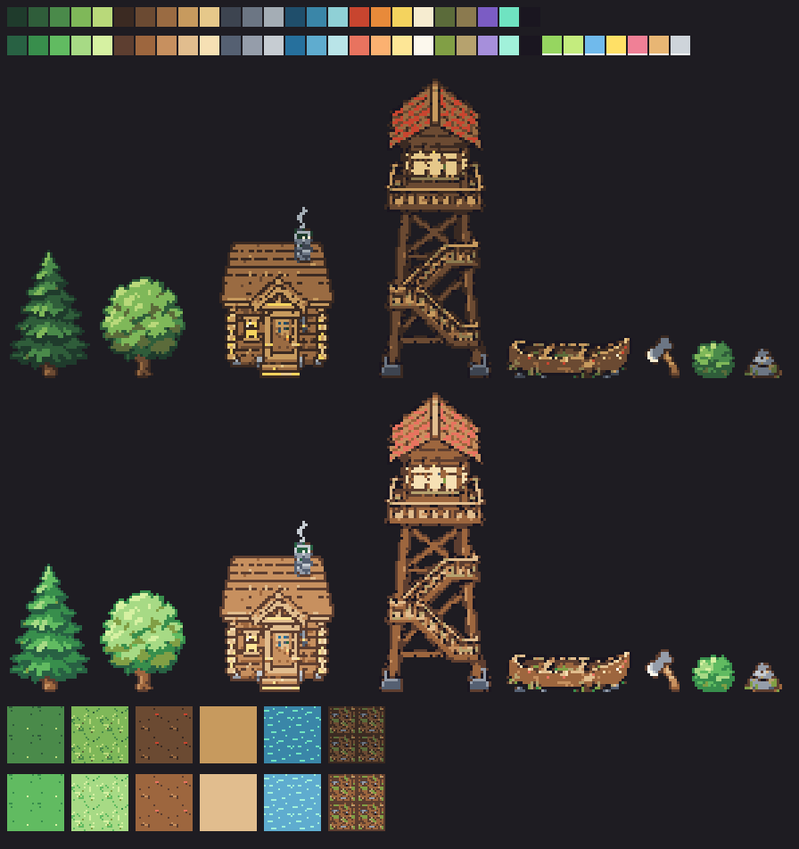

# Strange Ranger: Art Request 03, the Refresh

From the lab, 15 November 2026. Every picture in the game gets a clean, final version: crisp icons at a proper size, a brighter palette, and much more variety on the ground. There are 12 sheets, with a prompt for each.

## Why things look "bitty" now, and what changes

Your sheets are drawn large (about 1254 pixels), and the lab shrinks each item to its game size. A backpack icon was 16 × 16, so a detailed drawing got squashed into 256 pixels, and the game then showed it about four times bigger. The detail turns into speckle. Four changes fix it:

1. **Icons go up to 32 × 32.** The backpack, item bar and weather symbol use 32 × 32 icons, drawn at the same size on screen, so they get four times the detail. The world stays at 16-pixel tiles, so the look and the map don't change.
2. **Real pixel art.** The prompts below ask for true pixel art on a fixed grid: each art pixel a solid square, with no blur or soft shading. The lab's cleanup tool will look for that grid and sample it pixel for pixel, instead of averaging.
3. **A brighter palette** for your approval (see below).
4. **Variety on the ground.**
   - Four versions of every ground tile, mixed at random so no stretch looks stamped.
   - An optional sheet of small ground details (flowers, pebbles, leaves) scattered over the ground.
   - A second version of each tree.

   The game picks these as it draws, so the land itself stays exactly the same.

## The brighter palette: please approve

The lab lifted the mid-tones, made the greens and warm colours a little richer, and kept the darkest colours dark for outlines. Seven bright accents were added: sunny green, new leaf, sky blue, buttercup yellow, wildflower pink, fresh-cut wood and pale stone. That makes 32 colours.

How to read the preview:

- **Top row:** today's 25 colours.
- **Second row:** the brighter 32. The new accents are underlined in white.
- **Pictures:** game art as it is today, then the same art recoloured with the new palette.
- **Ground swatches:** before, then after.

**The 32 colours (hex):**

`286143 388e4c 61bb61 a7da85 d6f1a2 5d3e30 9d663e c7905f e1bd8e f6e0b4 556072 959daa c6ccd2 26709d 5faccf b9e4e8 e8735f fbb171 fde696 fcf8ed 819f45 b6a26e a68fdb a1f1da 1a1620 96d660 c4ec7e 70baec ffe066 f08096 e8b674 ced4da`

- [ ] Use this brighter palette
- [ ] Brighter still
- [ ] Not this bright

## Getting crisp pixel art from an image tool

These tips matter more than anything else in this document:

- **Start every prompt with the style line below.** It asks for real pixel art.
- **Name the grid size.** For example: "each item is 32 by 32 pixel art". The tool may not obey exactly, but it helps a lot.
- **If a result looks smooth or painterly, regenerate it.** Blurry edges, soft gradients and glows don't survive the shrink.
- **Fewer, bigger shapes read better than lots of fine detail.** A 32 × 32 icon has room for about three colours of shading per surface.
- **Keep the same lighting:** light from the top left, on every sheet.
- **Leave clear space between items.** Nothing crosses a cell edge, and each item is one connected piece.
- **Ground tiles fill their whole cell, edge to edge,** and must tile seamlessly. All four versions of a ground share the same base colour, so they mix without seams.

**Style line, at the start of every prompt:**

> True pixel art sprite sheet, crisp hard-edged pixels on an exact grid, every pixel a solid square, no anti-aliasing, no blur, no gradients, no soft shadows, flat shading with at most three tones per surface, one-pixel dark brown outline, light from the top left, cozy 16-bit style like Stardew Valley, bright cheerful forest palette, transparent background.

## The sheets

| # | File | Grid | What | Size in game |
| --- | --- | --- | --- | --- |
| 1 | `refresh_icons_tools.png` | 4 × 4 | Tools and materials icons | 32 × 32 |
| 2 | `refresh_icons_food_weather.png` | 4 × 4 | Food, other icons and weather | 32 × 32 |
| 3 | `refresh_ground_a.png` | 4 × 6 | Ground: grass, tall grass, forest floor, trail, shallows, deep water | 16 × 16 |
| 4 | `refresh_ground_b.png` | 4 × 3 | Ground: rock, bog, bridge boards | 16 × 16 |
| 5 | `refresh_ground_details.png` | 4 × 4 | Optional small ground details | 16 × 16 |
| 6 | `refresh_trees.png` | 4 × 2 | Trees, two of each | 32 × 48 |
| 7 | `refresh_objects_small.png` | 4 × 4 | Small outdoor objects | 16 × 16 |
| 8 | `refresh_objects_tall.png` | 4 × 2 | Tall and long objects | as listed |
| 9 | `refresh_objects_big.png` | 3 × 2 | Bigger objects | as listed |
| 10 | `refresh_buildings.png` | 3 × 2 | Buildings | as listed |
| 11 | `refresh_interior.png` | 4 × 3 | Indoors | as listed |
| 12 | `refresh_ranger.png` | 4 × 4 | The ranger walking | 16 × 32 each |

---

### Sheet 1: Tools and materials icons (32 × 32 each)

| | 1 | 2 | 3 | 4 |
| --- | --- | --- | --- | --- |
| **Row 1** | Hammer | Lantern | Folded map | Compass |
| **Row 2** | Pencil | Axe | Saw | Shovel |
| **Row 3** | Rolled bedroll | Firewood bundle | Planks | Nails |
| **Row 4** | Roof shingles | Window glass pane | Repair kit (planks tied with rope, nails) | Wooden arrow trail sign |

> [Style line]. A 4 by 4 grid of backpack item icons, each item 32 by 32 pixel art, centred in its cell with clear space around it. Row 1: a claw hammer; a brass camping lantern with a warm flame; a folded paper trail map; a brass compass. Row 2: a yellow pencil; a wood axe; a hand saw; a garden shovel. Row 3: a rolled green bedroll tied with straps; a small bundle of split firewood; a stack of three sawn planks; a handful of iron nails. Row 4: a small stack of wooden roof shingles; a clear glass window pane with a shine; a bundle of planks tied with rope with a few nails; a small wooden arrow trail sign on a post.

### Sheet 2: Food, other icons and weather (32 × 32 each)

| | 1 | 2 | 3 | 4 |
| --- | --- | --- | --- | --- |
| **Row 1** | Tin of beans | Apple | Sandwich | Steaming mug of soup |
| **Row 2** | Two red-topped marker posts | Handwritten journal page | Sun | Moon |
| **Row 3** | Grey cloud | Cloud with rain | Fog bands | Dark cloud with lightning |
| **Row 4** | Cloud with snowflakes | Blizzard streaks | (empty) | (empty) |

> [Style line]. A 4 by 4 grid of icons, each 32 by 32 pixel art, centred in its cell. Row 1: a tin can of beans with a label; a shiny red apple with a leaf; a thick sandwich; a steaming tin mug of soup. Row 2: two short wooden posts with red painted tops lying together; a handwritten journal page with a torn edge; a bold round sun; a bold crescent moon. Row 3: a soft grey cloud; a cloud with blue raindrops; three soft horizontal fog bands; a dark cloud with a yellow lightning bolt. Row 4: a cloud with white snowflakes; slanted white blizzard streaks; the last two cells empty. The weather icons are simple and bold, readable at a glance.

### Sheet 3: Ground A (16 × 16 each, four versions per row)

Each row is one kind of ground in four versions: same base colour, different small details. **Every tile fills its cell edge to edge and tiles seamlessly with itself and with the other three in its row.**

| Row | Ground | The four versions |
| --- | --- | --- |
| 1 | Grass | plain short grass; with a few blades; with a tiny flower; with a clover patch |
| 2 | Tall grass | thick tall grass, four different clumpings |
| 3 | Forest floor | dark earth with needles; with leaves; with a twig; with moss |
| 4 | Trail | packed dirt; with pebbles; with a root; with footprints |
| 5 | Shallow water | clear shallow water with ripples, four ripple patterns |
| 6 | Deep water | dark deep water, four gentle wave patterns |

> [Style line]. A 4 by 6 grid of seamless square ground tiles for a top-down game, each 16 by 16 pixel art filling its whole cell edge to edge, no outline, no transparency. Each row is one ground in four versions that share the same base colour and tile seamlessly together. Row 1: bright short grass, plain, with a few blades, with a tiny flower, with clover. Row 2: thick tall grass in four clumpings. Row 3: dark forest floor earth with pine needles, with leaves, with a twig, with moss. Row 4: packed dirt trail, plain, with pebbles, with a small root, with footprints. Row 5: clear shallow water with four ripple patterns. Row 6: dark deep water with four gentle wave patterns.

### Sheet 4: Ground B (16 × 16 each, four versions per row)

| Row | Ground | The four versions |
| --- | --- | --- |
| 1 | Rock | grey rock face, four crack patterns |
| 2 | Bog | wet dark earth with moss and small puddles, four arrangements |
| 3 | Bridge boards | weathered planks running left to right, four wear patterns |

> [Style line]. A 4 by 3 grid of seamless square ground tiles for a top-down game, each 16 by 16 pixel art filling its whole cell edge to edge, no outline, no transparency. Each row is one ground in four versions that share the same base colour and tile seamlessly. Row 1: grey rock face with four different crack patterns. Row 2: boggy wet dark earth with moss and small shallow puddles, four arrangements. Row 3: weathered wooden bridge planks running left to right, four wear patterns.

### Sheet 5 (optional): Ground details (16 × 16 each)

Small things scattered over the ground for variety. Each one is small, sits in the middle of its cell, and has a transparent background.

> [Style line]. A 4 by 4 grid of tiny ground details for a top-down game, each 16 by 16 pixel art, small and centred, transparent background. Row 1: a few white daisies; a few yellow buttercups; a few pink wildflowers; a dandelion. Row 2: three small pebbles; a flat stone; a fallen pinecone; a small twig. Row 3: a few fallen leaves; a tuft of grass; a small fern sprout; a patch of clover. Row 4: a moss patch; two small brown mushrooms; a tiny puddle; scattered pine needles.

### Sheet 6: Trees (32 × 48 each, two of each kind)

> [Style line]. A 4 by 2 grid of trees for a top-down game, each 32 pixels wide and 48 tall, pixel art standing on the bottom of its cell, each one connected piece. Row 1: a tall pine; a second pine, slightly different shape; a fir tree; a second fir. Row 2: a round leafy oak; a second oak, a little smaller; a dead grey tree with bare branches; a second dead tree, leaning.

### Sheet 7: Small outdoor objects (16 × 16 each)

| | 1 | 2 | 3 | 4 |
| --- | --- | --- | --- | --- |
| **Row 1** | Bush | Berry bush | Boulder | Tree stump |
| **Row 2** | Unlit fire pit | Lit campfire | Bedroll laid out | Mushrooms |
| **Row 3** | Wire fence section | Brush | Thorny thicket | Survey stake with ribbon |
| **Row 4** | Stone cairn | Trail marker post | Arrow sign on post | Tiny door |

> [Style line]. A 4 by 4 grid of small outdoor objects for a top-down game, each 16 by 16 pixel art, standing on the bottom of its cell, each one connected piece. Row 1: a round green bush; a bush with dark berries; a grey boulder; a cut tree stump. Row 2: a ring of stones with charred logs; a small lit campfire whose flames touch the logs; a green bedroll unrolled flat, seen from above; a cluster of red-capped mushrooms. Row 3: a section of old wire fence with two wooden posts; a tangle of low scrubby brush; a dense dark thorny bramble with berries; a thin wooden stake with a red ribbon. Row 4: a small cairn of flat grey stones; a short wooden post with a red top; a wooden arrow sign on a post; a tiny wooden door with a little doormat.

### Sheet 8: Tall and long objects

| Cell | Game size | What |
| --- | --- | --- |
| 1 | 16 × 32 | Park gate: two posts and two rails |
| 2 | 16 × 32 | Scenic outlook post with a small sign |
| 3 | 16 × 32 | Bridge end post |
| 4 | 16 × 32 | Notice board on a post, prices scratched out |
| 5 | 48 × 16 | Fallen tree trunk lying on its side |
| 6 | 32 × 48 | Pine tree with words carved in the bark |
| 7 | 16 × 16 | A few muddy pawprints |
| 8 | (empty) | |

> [Style line]. A 4 by 2 grid of separate objects for a top-down game, pixel art, each one connected piece, standing on the bottom of its cell. Row 1: a rustic wooden park gate, two posts and two rails, tall and narrow; a wooden scenic outlook post with a small sign, tall and narrow; a thick weathered bridge end post; a wooden notice board on a post listing prices that are all scratched out. Row 2: a long fallen tree trunk lying on its side, three times wider than tall; a pine tree with words carved into its bark; a few small muddy pawprints; the last cell empty.

### Sheet 9: Bigger objects

| Cell | Game size | What |
| --- | --- | --- |
| 1 | 48 × 16 | Battered old red canoe with a name on the bow |
| 2 | 48 × 32 | Three-sided wooden lean-to shelter |
| 3 | 32 × 32 | Big round lumpy boulder like a sleeping animal |
| 4 | 32 × 16 | Mossy stone bench |
| 5 | 48 × 32 | Rusty park truck with a young tree through the hood |
| 6 | 32 × 16 | Blackberry bramble with a small round tunnel |

> [Style line]. A 3 by 2 grid of separate objects for a top-down game, pixel art, each one connected piece. Row 1: a battered old red wooden canoe lying on the ground with a name painted on the bow, long and low; a small three-sided wooden lean-to with a sloping roof, open at the front; a big round lumpy grey boulder shaped like a curled-up sleeping animal. Row 2: an old mossy stone bench; an old rusty park truck with flat tyres and a young tree growing through the hood; a low blackberry bramble with a small smooth round tunnel through it.

### Sheet 10: Buildings

| Cell | Game size | What |
| --- | --- | --- |
| 1 | 96 × 80 | The ranger station: a cozy log building with a porch, a door in the middle and a chimney |
| 2 | 64 × 64 | The old cabin, run-down: holes in the roof, broken window, door off its hinges |
| 3 | 64 × 64 | The same cabin, repaired: warm glowing window |
| 4 | 48 × 112 | Fire tower, run-down |
| 5 | 48 × 112 | Fire tower, repaired |
| 6 | (empty) | |

> [Style line]. A 3 by 2 grid of buildings for a top-down game seen from slightly above, pixel art, each one connected piece, standing on the bottom of its cell. Row 1: a cozy log ranger station with a porch, a door in the middle, two windows and a stone chimney, wider than tall; a small run-down log cabin with holes in the roof, a broken window and the door hanging off; the same small cabin repaired, with a warm glowing window. Row 2: a tall wooden fire lookout tower on four braced legs with a zigzag staircase and a small cab with a red roof, run-down with missing shingles and broken windows; the same tower repaired, with warm glowing windows; the last cell empty.

### Sheet 11: Indoors

| Cell | Game size | What |
| --- | --- | --- |
| 1 | 16 × 16 | Wooden floor tile (seamless, fills its cell) |
| 2 | 16 × 16 | Log wall tile (seamless, fills its cell) |
| 3 | 32 × 32 | Bed with a quilt |
| 4 | 16 × 16 | Wooden storage chest |
| 5 | 16 × 16 | Door, seen from inside |
| 6 | 16 × 16 | Note board with paper notes |
| 7 | 16 × 16 | Old radio on a small table |
| 8 | 32 × 24 | Supply shelf with tins and jars |
| 9 | 16 × 24 | Wood stove, cold |
| 10 | 16 × 24 | Wood stove, lit |
| 11 | 32 × 24 | Workbench with tools |
| 12 | (empty) | |

> [Style line]. A 4 by 3 grid of cabin interior pieces for a top-down game, pixel art, seen from slightly above. Row 1: a seamless wooden floor tile filling its cell; a seamless log wall tile filling its cell; a bed with a patchwork quilt; a small wooden storage chest. Row 2: a wooden door seen from inside; a small cork note board with paper notes; an old radio on a small table; a wooden supply shelf with tins and jars. Row 3: a small black wood stove, cold and unlit; the same stove lit, with an orange glow in its window; a wooden workbench with a few tools; the last cell empty.

### Sheet 12: The ranger walking (16 × 32 each)

Four columns are four walking frames. The rows face down (toward the viewer), right, up (away) and left. Keep the same ranger: tan ranger hat, green shirt, brown trousers, small backpack.

> [Style line]. A 4 by 4 grid walk cycle sprite sheet of a park ranger for a top-down game, each frame 16 pixels wide and 32 tall, the same character in every frame: tan ranger hat, green shirt, brown trousers, small backpack. Four columns are four walking frames. Row 1 walking toward the viewer, row 2 walking right, row 3 walking away, row 4 walking left. Even spacing, each frame centred in its cell.

---

## What the lab will do when the sheets come back

- Clean each sheet with a grid-aware shrink, so true pixel art comes through pixel for pixel.
- Show icons at 32 × 32 in the backpack, item bar and weather symbol.
- Switch to the approved palette and re-clean every sheet against it.
- Mix the four ground versions, and the tree versions, by tile, so the world looks varied but the land stays exactly the same. Scatter the ground details where the ground suits them.
- Send you a cleanup report listing anything to redo.

## When you send it back

- [ ] Palette choice ticked
- [ ] Sheets 1 to 12 (sheet 5 is optional)

Name the files exactly as in the table, and tell the lab "art is in".
