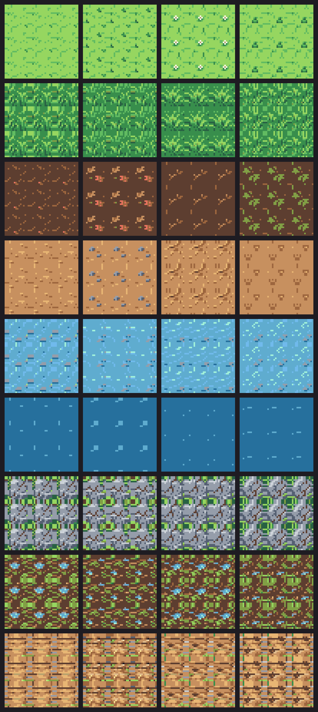
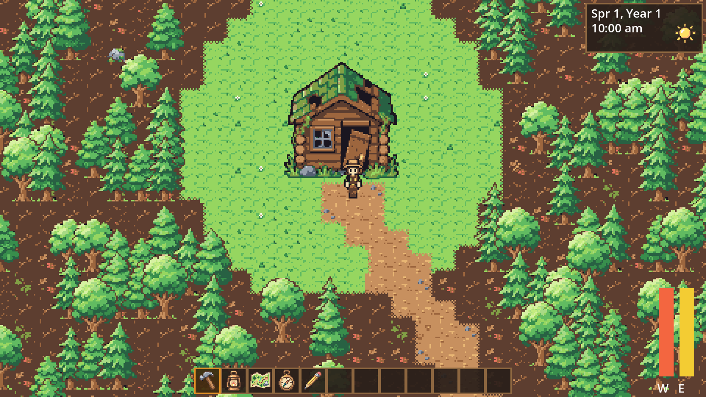

# Strange Ranger: Art Request 04, Calm Ground

From the lab, 16 November 2026. The refresh art is in the game and looks great: the icons, buildings, trees, objects and ranger all came through pixel for pixel. One thing still reads "bitty": the ground. This request asks for calmer ground tiles, plus three indoor pieces that didn't fit. There are 3 sheets, with a prompt for each.

The tiles are already the right size (16 × 16). The bitty look comes from what's drawn inside them.

## What makes the ground bitty

Each row is one ground. Each block shows one of its four versions, tiled 3 by 3, as the game lays it. In order: grass, tall grass, forest floor, trail, shallow water, deep water, rock, bog, bridge boards.

1. **Lone pixels.** Most marks are a single pixel: the dark grass ticks, the red dots on the forest floor and the pale specks on the water. On screen, single pixels sparkle like static.
2. **The same mark in the same place on every tile.** When a tile repeats, every mark lines up with its neighbours into a grid of dashes. You can see this in the grass, the trail footprints and the bog puddles.
3. **Too many colours in one tile.** Rock, bog, boards and tall grass use five to nine colours in a tile, so they read as a busy carpet. The rock's bright green moss makes the cliffs look patterned instead of solid.

Deep water is the one that already works: one flat blue with a few small, quiet marks. Every ground should feel like that.

## The rules for calm ground

These matter more than anything else in this document:

- **One base colour covers most of the tile,** at least 85% of it. Rock, bog and boards can have a second big shape, but no confetti.
- **No lone pixels.** Every mark is a small clump of 2 to 4 pixels that touch.
- **Few marks.** The first version of each ground has at most 2 small marks. The other three have at most 4.
- **Marks stay away from the tile edges and off a regular grid,** so repeated tiles don't line up into rows of dashes. Put them at odd, uneven spots.
- **At most 3 colours in a tile:** the base, one darker and one lighter. Rock, bog and boards may use 4.
- **The first version is the calmest.** The game shows it on most tiles (about 80%) and mixes in the other three now and then.
- **Same size, same layout and same palette as Art Request 03.** Every tile fills its cell edge to edge and tiles seamlessly with itself and with the other versions in its row.

**Style line, at the start of every prompt:**

> True pixel art sprite sheet, crisp hard-edged pixels on an exact grid, every pixel a solid square, no anti-aliasing, no blur, no gradients, flat calm colours, cozy 16-bit farming game style, bright cheerful forest palette, light from the top left.

**Calm line, after the style line in the ground prompts:**

> Calm, quiet ground tiles: each tile is mostly one flat base colour, with only two to four small clumps of two to four pixels in a slightly darker or lighter shade, placed unevenly and away from the edges. No single stray pixels, no speckle, no noise, no dithering, no repeating dash patterns.

The 33 colours (hex), unchanged from Art Request 03:

`286143 388e4c 61bb61 a7da85 d6f1a2 5d3e30 9d663e c7905f e1bd8e f6e0b4 556072 959daa c6ccd2 26709d 5faccf b9e4e8 e8735f fbb171 fde696 fcf8ed 819f45 b6a26e a68fdb a1f1da 1a1620 96d660 c4ec7e 70baec ffe066 f08096 e8b674 ced4da 1f4e6b`

## The sheets

| # | File | Grid | What | Size in game |
| --- | --- | --- | --- | --- |
| 1 | `calm_ground_a.png` | 4 × 6 | Ground: grass, tall grass, forest floor, trail, shallows, deep water | 16 × 16 |
| 2 | `calm_ground_b.png` | 4 × 3 | Ground: rock, bog, bridge boards | 16 × 16 |
| 3 | `calm_interior.png` | 3 × 1 | Indoors: floor, wall, door | 16 × 16 |

Please draw each sheet at exactly game size, as last time: 64 × 96, 64 × 48 and 48 × 16 pixels. That came through perfectly.

### Sheet 1: Ground A (16 × 16 each, four versions per row)

| Row | Ground | Version 1 (calmest, most common) | Versions 2 to 4 |
| --- | --- | --- | --- |
| 1 | Grass | flat bright green, two tiny darker blade clumps | a few blades; one tiny white flower; a small clover clump |
| 2 | Tall grass | a deeper green than grass, with three or four big soft clumps of blades | the clumps placed differently |
| 3 | Forest floor | flat dark earth, two small needle clumps | a few leaves; a twig; a small moss patch |
| 4 | Trail | flat packed dirt, one or two faint darker clumps | two pebbles; a small root; one faint footprint |
| 5 | Shallow water | flat clear blue, one short pale ripple | ripples placed differently |
| 6 | Deep water | flat deep blue, one or two faint ripples (today's are good) | ripples placed differently |

> [Style line]. [Calm line]. A 4 by 6 grid of seamless square ground tiles for a top-down game, each 16 by 16 pixel art filling its whole cell edge to edge, no outline, no transparency. Each row is one ground in four versions that share the same base colour and tile seamlessly together; the first in each row is the plainest. Row 1: bright short grass, almost flat, with a couple of tiny blade clumps; a few blades; one tiny white flower; a small clover clump. Row 2: deeper green tall grass made of three or four big soft clumps of blades, four arrangements. Row 3: flat dark forest earth with two small pine needle clumps; a few fallen leaves; a small twig; a small moss patch. Row 4: flat packed dirt trail with one or two faint marks; two pebbles; a small root; one faint footprint. Row 5: flat clear shallow water with one short pale ripple, four placements. Row 6: flat dark deep water with one or two faint ripples, four placements.

### Sheet 2: Ground B (16 × 16 each, four versions per row)

| Row | Ground | Version 1 (calmest, most common) | Versions 2 to 4 |
| --- | --- | --- | --- |
| 1 | Rock | plain grey rock face, one long dark crack, **no moss** | cracks placed differently; one version may have a single small moss clump |
| 2 | Bog | dark wet earth with one smooth puddle | the puddle shaped and placed differently; one small moss clump |
| 3 | Bridge boards | planks running left to right, clear dark seams between them, quiet grain | a knot; a worn plank; a nail head |

> [Style line]. [Calm line]. A 4 by 3 grid of seamless square ground tiles for a top-down game, each 16 by 16 pixel art filling its whole cell edge to edge, no outline, no transparency. Each row is one ground in four versions that share the same base colour and tile seamlessly; the first in each row is the plainest. Row 1: plain solid grey rock face with one or two long dark cracks and a soft lighter edge, no moss, four crack placements, the last with one small moss clump. Row 2: dark wet boggy earth with one smooth shallow puddle, four puddle shapes and placements, one with a small moss clump. Row 3: weathered wooden bridge planks running left to right with clear dark seams and quiet wood grain; plain; with a knot; with a worn plank; with a nail head.

### Sheet 3: Indoors (16 × 16 each)

These three didn't fit last time: the floor and wall were drawn as 14 × 15 squares, and the door was 18 × 24. Each one must fill its 16 × 16 cell exactly.

| Cell | Piece |
| --- | --- |
| 1 | Wooden floor tile: planks running left to right, seamless, edge to edge |
| 2 | Log wall tile: two or three horizontal logs, seamless left to right, edge to edge |
| 3 | Door seen from inside: a plain wooden door filling the whole 16 × 16 cell |

> [Style line]. A 3 by 1 row of cabin interior tiles for a top-down game, each exactly 16 by 16 pixel art filling its whole cell edge to edge, no transparency, calm with few colours. Cell 1: a seamless warm wooden floor tile with planks running left to right. Cell 2: a seamless log wall tile with two or three horizontal logs. Cell 3: a plain wooden door seen from inside, filling the whole cell.

## What the lab will do when the sheets come back

- Clean each sheet pixel for pixel, as last time. The new tiles replace the Art Request 03 ground tiles; nothing else changes.
- Show version 1 of each ground on most tiles and mix in the other three now and then.
- Use the new floor, wall and door indoors.
- Send you before-and-after screenshots.

## Meanwhile

The lab has already calmed things down with the tiles you sent: the game now shows the quietest version of each ground on most tiles, and scatters the small details about a third as often as before. The in-game screenshot above is with that change.

## When you send it back

- [x] Sheet 1: Ground A
- [x] Sheet 2: Ground B
- [x] Sheet 3: Indoors

Received 16 November 2026 and in the game.

## What the lab did with them

- All 39 tiles came through cleanly: exact size, all from the 33 colours, no lone pixels, two or three colours per ground tile.
- Tried in the game on 16 November 2026, the designer judged the result worse. The sheets are kept in art/raw/ but are not used.
- The game is back on the Art Request 03 ground tiles, with the calmest version of each ground shown on most tiles and the details kept rare.
