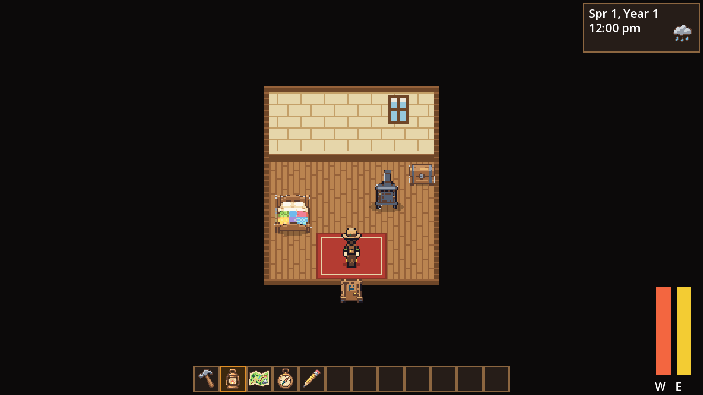
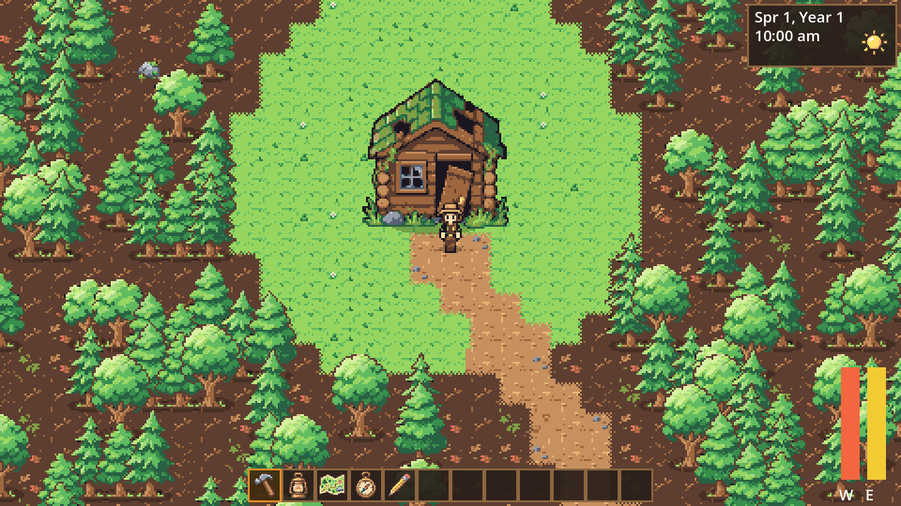
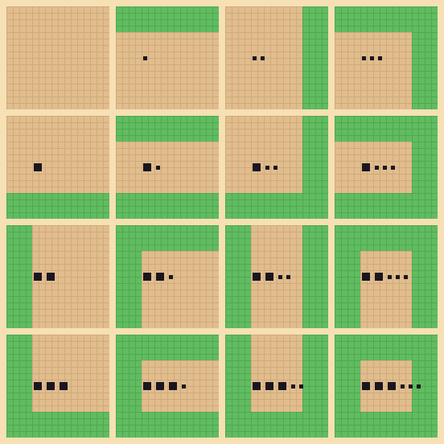

# Strange Ranger: Art Request 05, Cozy Rooms and Soft Ground

From the lab, 16 November 2026. The buildings, trees, objects, ranger and icons are where we want them. Two things still don't feel like a cozy farming game: the ground and the rooms. This request asks for 5 sheets, with a prompt for each.

The calm ground tiles from Art Request 04 came through cleanly, but with no texture at all the ground looked flat and empty, so the game is back on the Art Request 03 tiles. This time we want the middle: plenty of texture, all in close shades.

## What changes in the game (already done)

- **Shadows.** Trees, buildings, objects, furniture and the ranger now sit on a soft see-through oval, so they look planted.
- **Rooms have a tall back wall.** The top three rows of every room are a wall seen from the front, with windows. The floor is below it, and the other three sides are a thin dark trim. Furniture stands against the back wall.
- **Bigger furniture spots.** The bed is now 2 × 3 tiles, the stove 2 × 2, the workbench 3 wide. Today's furniture pictures are too small for these spots, so they float away from the wall until the new ones arrive.

The two reference screenshots in the email show the kind of look we're aiming for: the feel, not the pictures. Please don't copy them.

## The rules

**Texture in close shades.** This is the one that matters most.

- Ground has plenty of texture: grass blades, soil grain, small clumps.
- Every mark is only one or two shades away from the base colour. No near-black and no white on the ground.
- Marks are clumps of 2 to 4 pixels. No single stray pixels.
- Marks sit at uneven spots, away from the tile edges, so repeated tiles don't line up into rows.

**Rooms read at a glance.** The wall is light, the floor a warm mid tone, and the trim and outlines dark.

**Furniture is big and stands on the bottom of its cell.** Its back edge is against the wall, with a one-pixel dark outline and light from the top left.

**Same palette and same way of drawing as Art Request 03:** true pixel art at exactly game size, from the same 33 colours.

`286143 388e4c 61bb61 a7da85 d6f1a2 5d3e30 9d663e c7905f e1bd8e f6e0b4 556072 959daa c6ccd2 26709d 5faccf b9e4e8 e8735f fbb171 fde696 fcf8ed 819f45 b6a26e a68fdb a1f1da 1a1620 96d660 c4ec7e 70baec ffe066 f08096 e8b674 ced4da 1f4e6b`

**Style line, at the start of every prompt:**

> True pixel art sprite sheet, crisp hard-edged pixels on an exact grid, every pixel a solid square, no anti-aliasing, no blur, no gradients, warm cozy 16-bit farming game style, bright cheerful forest palette, light from the top left.

**Texture line, after the style line in the ground prompts:**

> Rich but soft texture: many small grass blades or soil grains in shades only slightly darker or lighter than the base colour, in small clumps of two to four pixels, placed unevenly. No near-black or white marks, no single stray pixels, no repeating rows.

## The sheets

| # | File | Size | What |
| --- | --- | --- | --- |
| 1 | `ar05_ground.png` | 64 × 48 | Grass, forest floor and trail, four versions each |
| 2 | `ar05_edges.png` | 128 × 64 | Soft raised edges: grass, then forest floor |
| 3 | `ar05_room_tiles.png` | 48 × 16 | Back wall, back wall with skirting, floor |
| 4 | `ar05_room_decor.png` | 144 × 32 | Window, rug, picture |
| 5 | `ar05_furniture.png` | 192 × 96 | Eight pieces of furniture |

### Sheet 1: Ground (16 × 16 each, four versions per row)

| Row | Ground | Version 1 (most common) | Versions 2 to 4 |
| --- | --- | --- | --- |
| 1 | Grass | a bright mid green full of soft blades in close greens | a few more blades; a small clover clump; a tiny pale-yellow flower |
| 2 | Forest floor | dark warm earth with soft needle and leaf texture in close browns | a few fallen needles; a leaf; a small moss clump in a muted green |
| 3 | Trail | warm sandy dirt, almost flat, with faint soft grain | faint grain placed differently; two small pebbles in close tans; a faint footprint |

> [Style line]. [Texture line]. A 4 by 3 grid of seamless square ground tiles for a top-down game, each 16 by 16 pixel art filling its whole cell edge to edge, no outline, no transparency. Each row is one ground in four versions that share the same base colour and tile seamlessly together. Row 1: bright mid-green grass full of soft blades in close greens; with a few more blades; with a small clover clump; with one tiny pale yellow flower. Row 2: dark warm forest earth with soft needle and leaf texture in close browns; with a few fallen needles; with one leaf; with a small muted moss clump. Row 3: warm sandy packed dirt trail, almost flat with faint soft grain; grain placed differently; with two small pebbles in close tans; with a faint footprint.

### Sheet 2: Soft raised edges (two 64 × 64 blocks side by side)

This is the edge where grass meets the trail (and other lower ground), and where forest floor meets grass. Today the game cuts a hard saw-tooth edge. We want the higher ground to look slightly raised: a soft wavy edge, a slightly darker rim just inside it, a thin shadow on the lower ground, and a few blades hanging over.

Each block is a 4 by 4 grid of 16 × 16 cells. **Each cell shows the higher ground creeping in from one or more sides, and is see-through everywhere else**, so the lower ground shows beneath. The guide shows which sides each cell has:

- Cell 0 (top left) is empty.
- In the guide, the green band is about 4 pixels deep. Yours can wave between 2 and 5 pixels deep, as long as the cells join up with each other and with the full tile.
- The left block is grass, matching sheet 1's grass. The right block is forest floor, matching sheet 1's forest floor.

> [Style line]. Two 4 by 4 grids of 16 by 16 pixel art edge tiles for a top-down game, transparent background. Each cell shows a band of ground creeping in from one or more sides of the cell, as in the attached guide, with a soft wavy edge, a slightly darker rim just inside the edge, a thin soft shadow just outside it, and a few blades hanging over. The rest of each cell is transparent. Left grid: bright mid-green grass in close greens. Right grid: dark warm forest earth with needles in close browns.

### Sheet 3: Room tiles (16 × 16 each)

| Cell | Piece |
| --- | --- |
| 1 | **Back wall:** pale peeled logs or whitewashed boards running across, seamless left to right and top to bottom, light and calm |
| 2 | **Back wall, bottom row:** the same wall with a dark wooden skirting board along the bottom 5 or 6 pixels |
| 3 | **Floor:** warm mid-brown planks running up and down, staggered joints, soft grain in close shades, seamless |

> [Style line]. A 3 by 1 row of seamless 16 by 16 pixel art tiles for the inside of a cozy log cabin, top-down game, each filling its cell edge to edge. Cell 1: a pale, light back wall of whitewashed boards or peeled logs running across, seen from the front. Cell 2: the same wall with a dark wooden skirting board along the bottom. Cell 3: a warm mid-brown wooden floor with planks running up and down, staggered joints and soft grain.

### Sheet 4: Room decor (three 48 × 32 cells)

| Cell | Piece | Size |
| --- | --- | --- |
| 1 | Window on the back wall: wooden frame, four panes of sky, a little warm light | 32 × 32 |
| 2 | Rug: an oval or rectangular woven rug in warm reds and creams | 48 × 32 |
| 3 | Small framed picture of a mountain or a pine | 16 × 16 |

> [Style line]. A 3 by 1 row of separate pixel art pieces for a cozy cabin interior, top-down game seen from the front, transparent background, each centred in its cell. Cell 1: a 32 by 32 wooden-framed window with four panes of blue sky and a little warm light. Cell 2: a 48 by 32 woven rug in warm reds and creams seen from above. Cell 3: a 16 by 16 small framed picture of a mountain and pines.

### Sheet 5: Furniture (four 48 × 48 cells across, two rows)

Each piece stands on the bottom middle of its cell, seen from slightly above, with its back against an unseen wall.

| Cell | Piece | Size |
| --- | --- | --- |
| Row 1, 1 | Bed: wooden frame, plump pillow, patchwork quilt | 32 × 48 |
| Row 1, 2 | Wood stove, cold: black iron with a pipe going up | 32 × 40 |
| Row 1, 3 | The same stove lit, with orange glow in its window | 32 × 40 |
| Row 1, 4 | Supply shelf: tall wooden shelves with tins and jars | 32 × 32 |
| Row 2, 1 | Workbench: long wooden bench with a vise and a few tools | 48 × 32 |
| Row 2, 2 | Desk: small wooden desk with a logbook | 32 × 24 |
| Row 2, 3 | Old radio on a small side table | 16 × 24 |
| Row 2, 4 | Cork note board on a short stand, with paper notes | 16 × 24 |

> [Style line]. A 4 by 2 grid of cozy cabin furniture for a top-down game seen from slightly above, pixel art, transparent background, each one connected piece standing on the bottom middle of its cell, one-pixel dark outline. Row 1: a 32 by 48 wooden bed with a plump pillow and patchwork quilt; a 32 by 40 black iron wood stove with a pipe going up, cold; the same stove lit with an orange glow in its window; a 32 by 32 tall wooden supply shelf with tins and jars. Row 2: a 48 by 32 long wooden workbench with a vise and a few tools; a 32 by 24 small wooden desk with a logbook; a 16 by 24 old radio on a small side table; a 16 by 24 cork note board on a short stand with paper notes.

## What the lab will do when the sheets come back

- Clean each sheet pixel for pixel, as before.
- Use the new grass, forest floor and trail tiles, and the soft edges in place of the cut ones.
- Use the new wall, floor, window, rug, picture and furniture in all three rooms.
- Send before-and-after screenshots.

## When you send it back

- [ ] Sheet 1: Ground
- [ ] Sheet 2: Soft raised edges
- [ ] Sheet 3: Room tiles
- [ ] Sheet 4: Room decor
- [ ] Sheet 5: Furniture
