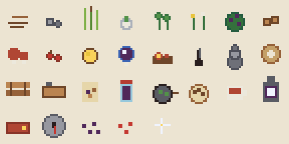

# Strange Ranger: Art Request 06, Living Out There

From the lab, 16 November 2026. Phase 2b adds things to gather, things to make and three refitted tools. They all use the lab's stand-ins today (below). This request asks for 3 sheets, with a prompt for each. Same palette and same way of drawing as Art Requests 03 and 05: true pixel art at exactly game size, from the same 33 colours.

The glowing violet mushrooms already in the game serve as the glowcap on the ground, as the spec asks, so only its backpack icon is new.

**Style line, at the start of every prompt:**

> True pixel art sprite sheet, crisp hard-edged pixels on an exact grid, every pixel a solid square, no anti-aliasing, no blur, no gradients, warm cozy 16-bit farming game style, bright cheerful forest palette, light from the top left.

## The sheets

| # | File | Size | What |
| --- | --- | --- | --- |
| 1 | `ar06_gathered_icons.png` | 128 × 128 | 14 backpack icons for things gathered, 32 × 32 each |
| 2 | `ar06_made_icons.png` | 128 × 96 | 12 backpack icons for things made, 32 × 32 each |
| 3 | `ar06_world.png` | 64 × 48 | 12 small things on the ground, 16 × 16 each |

### Sheet 1: Gathered (4 × 4 grid of 32 × 32 icons; the last two cells empty)

Row by row: sticks, stones, reeds, wild onion; fiddleheads, wildflowers, berries, hazelnuts; mushrooms, rose hips, pine resin, glowcap; ember moss, lodestone sliver.

- **Glowcap:** a small violet mushroom that gives off its own light.
- **Ember moss:** an orange moss on a scrap of dead wood, warm to the touch.
- **Lodestone sliver:** a splinter of dark stone.

> [Style line]. A 4 by 4 grid of 32 by 32 pixel art inventory icons for a top-down forest game, transparent background, each one item centred in its cell with a one-pixel dark outline. Row 1: a small bundle of sticks; three smooth stones; a bundle of reeds; a wild onion with its green top. Row 2: two curled fiddlehead ferns; a small posy of wildflowers; a sprig of dark berries; three hazelnuts. Row 3: two brown forest mushrooms; red rose hips on a twig; a golden drop of pine resin; a small violet mushroom glowing softly. Row 4: orange moss on a scrap of dead wood, faintly glowing; a dark splinter of stone with a dull shine; the last two cells empty.

### Sheet 2: Made (4 × 3 grid of 32 × 32 icons)

Row by row: cairn, rope, boardwalk, workbench kit; trail mix, berry preserve, fiddlehead fry, roast hazelnuts; rose hip tea, glowcap lantern, ember bedroll, true compass.

- The three refitted tools look like today's lantern, bedroll and compass icons with a touch of what went into them: a violet glow in the lantern, an orange warm glow along the bedroll, a dark needle with a faint shimmer on the compass.

> [Style line]. A 4 by 3 grid of 32 by 32 pixel art inventory icons for a top-down forest game, transparent background, each one item centred in its cell with a one-pixel dark outline. Row 1: a small stack of stones (a cairn); a coil of rope; a short length of wooden boardwalk planks; a flat-packed wooden workbench kit with a few nails. Row 2: a paper twist of trail mix; a jar of berry preserve with a cloth lid; fiddleheads frying in a small pan; roasted hazelnuts in a paper cone. Row 3: a mug of red rose hip tea; a camp lantern glowing violet inside; a rolled bedroll with a warm orange glow along it; a brass compass with a dark needle and a faint shimmer.

### Sheet 3: On the ground (4 × 3 grid of 16 × 16)

Row by row: sticks, stones, reeds, wild onion; fiddleheads, wildflowers, hazelnuts, mushrooms; ember moss, berries on a bush, rose hips on a bush, a sparkle.

- The first nine sit on the ground, small, on the bottom middle of the cell, with the ground showing around them (transparent background).
- **Berries on a bush** and **rose hips on a bush** are only the fruit, drawn to sit on top of the game's bush picture (16 × 16). Everything but the fruit is transparent.
- **Sparkle:** a small four-pointed twinkle, pale and soft, that the game fades in and out.

> [Style line]. A 4 by 3 grid of 16 by 16 pixel art pieces for a top-down forest game, transparent background, small things lying on the ground, each on the bottom middle of its cell. Row 1: a few fallen sticks; two or three small stones; a clump of reeds; a wild onion growing. Row 2: two fiddleheads uncurling; a few wildflowers; three hazelnuts on the ground; two brown mushrooms. Row 3: a small patch of orange moss with a faint glow; only a few clusters of dark berries, placed to sit on a round bush; only a few red rose hips, placed to sit on a bare round bush; a small pale four-pointed sparkle.

## What the lab will do when the sheets come back

- Cut each sheet pixel for pixel, as before.
- Use the icons in the backpack and item bar, and the ground pieces in the world.
- Send before-and-after screenshots.

## When you send it back

- [ ] Sheet 1: Gathered
- [ ] Sheet 2: Made
- [ ] Sheet 3: On the ground
