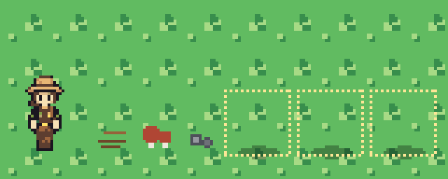

# Strange Ranger: Art Request 07, Forage You Can See

From the lab, 17 November 2026. In play, the forage on the ground is too hard to see: today's stand-ins are 16 × 16, low, dull and close to the colours of the ground, so they vanish into the grass. This request replaces **Sheet 3 of Art Request 06** ("On the ground") with bigger, brighter pieces that are easy to spot and nice to look at. Sheets 1 and 2 of Art Request 06 (the backpack icons) are unchanged.

*Left to right: the ranger for scale, today's stand-ins for sticks, mushrooms and stones, and three dotted 24 × 24 frames showing the size each new piece may fill, with the soft shadow it stands on.*

## What makes a piece easy to see

Each piece on the ground should follow these rules:

1. **Bigger.** Each piece fills most of a 24 × 24 cell, half again a tile, standing on the bottom middle. Today's are 16 × 16 and fill about half of that.
2. **A dark outline.** One pixel all round, in the darkest colour of the piece (not black), so the edge reads against any ground.
3. **A shadow.** A soft oval, two or three pixels tall, in a darker shade of the ground, under the piece. It lifts the piece off the ground. Draw it in the sheet, under each piece.
4. **Colour that is not the ground's.** Grass is mid-green and the forest floor is dark brown, so:
   - give each piece one warm or bright accent: a red cap, a yellow centre, a white stone, an orange glow;
   - keep greens (reeds, onion tops, fiddleheads) lighter and yellower than the grass, with a pale or red part as well.
5. **A highlight.** One or two pale pixels on the top-left of each piece, where the light falls, so it reads as round and solid.
6. **Simple shapes.** Two or three clear parts per piece, not many small specks. At game size the player should know what it is at a glance.

The game draws each piece with its bottom middle on the tile's bottom middle, so a 24 × 24 piece overhangs its tile a little on each side. That is intended. The game needs no other change.

## The sheet

| # | File | Size | What |
| --- | --- | --- | --- |
| 3 (new) | `ar07_world.png` | 96 × 72 | 12 pieces on the ground, 24 × 24 each, in a 4 × 3 grid |

Row by row: sticks, stones, reeds, wild onion; fiddleheads, wildflowers, hazelnuts, mushrooms; ember moss, berries on a bush, rose hips on a bush, a sparkle.

- **Sticks:** three or four sticks crossed, pale tan wood with darker ends, clearly lighter than the forest floor.
- **Stones:** two or three rounded stones, pale grey to near-white on top, with a blue-grey underside.
- **Reeds:** a clump of tall reeds with brown seed heads, yellow-green, taller than the rest.
- **Wild onion:** a white bulb half out of the ground with a tuft of light green leaves.
- **Fiddleheads:** two or three curled ferns, bright spring green with a pale curl.
- **Wildflowers:** a small posy of three flowers in different colours (yellow, white, pink) on short stems.
- **Hazelnuts:** three hazelnuts in their frilly green husks, warm brown shells with a light shine.
- **Mushrooms:** two or three mushrooms with bright red-brown caps and pale stalks.
- **Ember moss:** a patch of orange moss on a scrap of dead wood, with a few glowing pixels.
- **Berries on a bush** and **rose hips on a bush:** only the fruit, placed to sit on the game's 16 × 16 bush, drawn in the middle 16 × 16 of the cell with the rest transparent. Make the clusters bigger and bolder than today: dark purple berries with a pale shine on each, bright red rose hips, each cluster with a one-pixel dark outline.
- **Sparkle:** a soft four-pointed twinkle, pale yellow-white, about 9 pixels across, in the middle of the cell. The game fades it in and out.

**Prompt.** Start with the style line from Art Request 06, then:

> A 4 by 3 grid of 24 by 24 pixel art pieces for a top-down forest game, transparent background, each piece on the bottom middle of its cell, standing on a small soft dark oval shadow, with a one-pixel dark outline and a pale highlight on the top left. Bold, simple, readable shapes in warm bright colours that stand out from green grass and dark brown forest floor. Row 1: three or four pale crossed sticks; two or three pale grey rounded stones; a clump of yellow-green reeds with brown seed heads; a white wild onion bulb with light green leaves. Row 2: two curled bright green fiddlehead ferns; a posy of three small flowers, yellow, white and pink; three brown hazelnuts in frilly green husks; two mushrooms with bright red-brown caps and pale stalks. Row 3: a patch of glowing orange moss on a scrap of dead wood; only a few bold clusters of dark purple berries with a pale shine, centred to sit on a round 16 by 16 bush; only a few bold bright red rose hips, centred to sit on a bare round 16 by 16 bush; a soft pale four-pointed sparkle.

## Check before sending

- Put each piece on a patch of the game's grass and forest floor and step back from the screen. Each should be the first thing the eye finds.
- The pieces should look like they belong with the bush, the trees and the station: same palette, same light from the top left.

## What the lab will do when the sheet comes back

- Cut it pixel for pixel, as before, and use it in place of today's stand-ins.
- Send before-and-after screenshots of the same walk.

## Also done in the game today

- The grass, forest floor and tall grass tiles are quieter: the lab thinned their small marks (no new colours).
- Ground details that look like forage are gone: the small wildflowers, pebbles, twigs, mushrooms and flat stones. The rest are half as common.

So what can be picked is no longer hidden among things that cannot.
