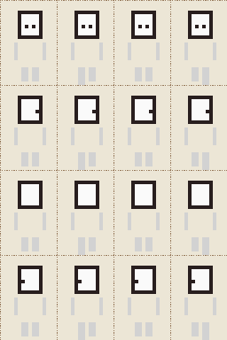
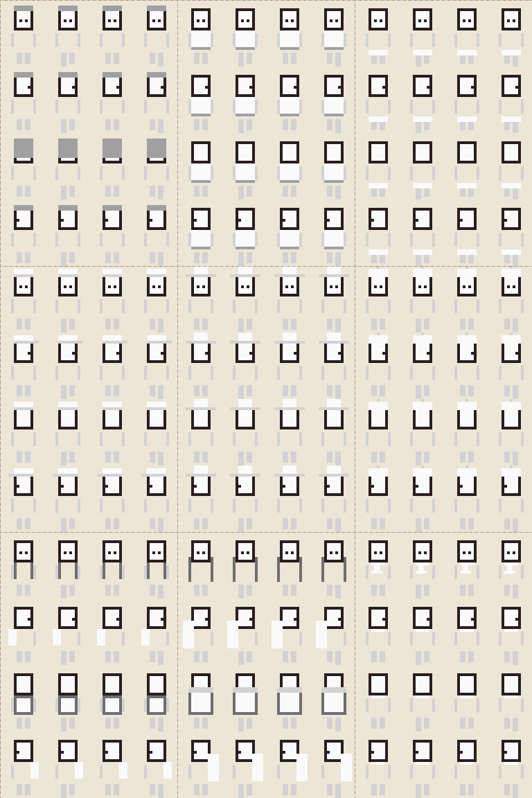
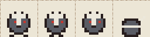

# Strange Ranger: Art Request 08, Visitors and the Troll Badger

From the lab, 17 November 2026. Phase 3 brings people into the park, and the Phase 3 spec asks for its art in two requests. This is the first: visitors, staff and the troll badger. (The spec calls them Art Requests 04 and 05; those numbers were used for earlier requests, so these are 08 and 09.)

Image generators find characters the hardest thing to draw, so the game builds every visitor from a few pictures: **one plain body**, plus **separate layers** for hair, clothes, hats, packs and a neckerchief. The game stacks the layers and colours each one, so a few pictures make hundreds of different visitors. Staff and tour guides are visitors in uniform colours, so they need no pictures of their own.

The stand-ins in the game today are shown in each section. They are plain shapes, only to show the grid.

## The sheets

| # | File | Size | What |
| --- | --- | --- | --- |
| 1 | `ar08_visitor_body.png` | 64 × 96 | The plain body: 4 walking frames across, 4 directions down, 16 × 24 each |
| 2 | `ar08_visitor_layers.png` | 192 × 288 | Nine layers in a 3 × 3 grid, each a full 64 × 96 body sheet |
| 3 | `ar08_troll_badger.png` | 64 × 16 | The troll badger: 4 frames of 16 × 16 |

### Rules for sheets 1 and 2

1. **The grid.** Each body sheet is 4 columns by 4 rows of 16 × 24 cells. Columns are the walking frames: standing, left foot forward, standing, right foot forward. Rows are the directions: facing down (towards the viewer), facing right, facing up (away), facing left.
2. **Same body everywhere.** The body stands on the bottom middle of its cell, about 14 pixels tall to the top of the head, a little shorter and rounder than the ranger. Every layer is drawn exactly on top of where the body is in the same cell, so the layers line up when stacked.
3. **Pale, for colouring.** Draw the skin, hair, clothes, hats and packs in **light greys only**, from white to mid grey, with a one-pixel dark outline. The game tints each layer (skin tones, hair colours, shirt colours), and greys tint cleanly. The eyes and outline stay dark.
4. **Transparent** everywhere outside the drawn shapes.

### Sheet 1: the body

A plain person in a vest and shorts: head with eyes, arms, legs. No hair, no clothes, nothing in the hands. Two dark pixels for eyes from the front, one from the side, none from behind.

**Prompt.** Start with the style line from Art Request 06, then:

> A 4 by 4 sprite sheet of 16 by 24 pixel art cells for a top-down forest game, transparent background. One small plain round-headed person, drawn only in pale greys with a one-pixel dark outline and two dark dot eyes, standing on the bottom middle of each cell. Columns: standing, left foot forward, standing, right foot forward. Rows: facing the viewer, facing right, facing away, facing left. No hair, no clothes, no colour.

### Sheet 2: the layers

*Each block shows a stand-in layer drawn over the body so you can see where it sits. Send the layers alone, without the body.*

Nine blocks, row by row, each a full 4 × 4 body sheet:

1. **Hair**: short hair, with the back of the head covered when facing away.
2. **Shirt**: a T-shirt covering the body from shoulders to waist.
3. **Trousers**: trousers or shorts, both legs, moving with the walk.
4. **Cap**: a peaked cap; the peak points the way the person faces.
5. **Wide hat**: a wide-brimmed hiking hat.
6. **Beanie**: a woolly hat with a bobble.
7. **Small pack**: a daypack: straps from the front, the pack from behind and the side.
8. **Big pack**: a tall camping pack with a rolled mat on top.
9. **Neckerchief**: a scout's neckerchief knotted at the throat.

**Prompt.**

> A 3 by 3 grid of sprite sheets for a top-down forest game, transparent background, each sheet 4 by 4 cells of 16 by 24 pixels, all for the same small round-headed person, drawn in pale greys only with a one-pixel dark outline, with nothing else in the cell. Columns: standing, left foot forward, standing, right foot forward. Rows: facing the viewer, facing right, facing away, facing left. Sheet 1: short hair. Sheet 2: a T-shirt. Sheet 3: trousers. Sheet 4: a peaked cap. Sheet 5: a wide-brimmed hiking hat. Sheet 6: a woolly bobble hat. Sheet 7: a small daypack, straps only from the front. Sheet 8: a tall camping pack with a rolled mat on top. Sheet 9: a knotted neckerchief.

### Sheet 3: the troll badger

Small, round, grumpy and hungry, about one tile, with a badger's white stripe, tiny red eyes and stubby legs. Four frames: walking (two), sitting up looking cross, and curled up asleep. Full colour: it is not tinted.

**Prompt.**

> A 4 by 1 sprite sheet of 16 by 16 pixel art cells for a top-down forest game, transparent background. A small, round, grumpy troll badger: grey body, a white stripe from nose to back, tiny red eyes, stubby legs, a one-pixel dark outline, on the bottom middle of each cell. Frame 1 and 2: waddling, legs alternating. Frame 3: sitting up, arms folded, looking cross. Frame 4: curled up asleep with a little "z".

## Check before sending

- Stack sheet 2's layers over sheet 1 in your head (or an editor): each hat sits on the head, the shirt on the body, the packs on the back, in every cell.
- The greys are light. A dark grey layer tints to a muddy colour.
- Put the badger on grass and forest floor. It should be easy to spot and look more funny than fierce.

## What the lab will do when the sheets come back

- Cut them pixel for pixel, with no change to code or data: the files replace today's stand-ins.
- Send screenshots of a family, a tour group and a scout troop on the trail.
