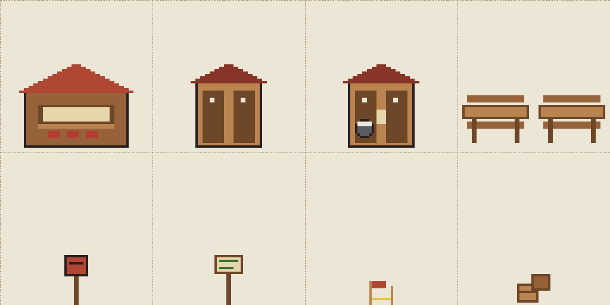
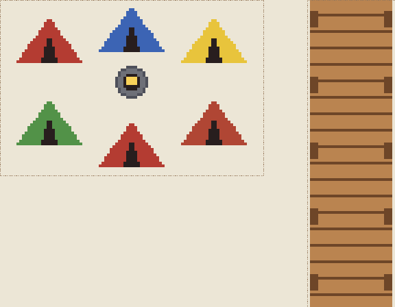
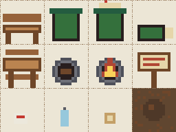
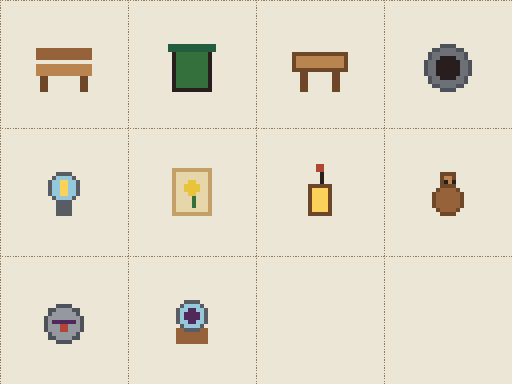
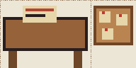

# Strange Ranger: Art Request 09, The Park's Things

From the lab, 17 November 2026. The second half of Phase 3's art: the facilities, small placed things, litter, the kiosk, the gift goods and two pieces of station furniture. The new screens (the catalog, the staff board, the book) use the game's usual panels and need no art.

Each section shows today's stand-in on the requested grid. Every piece stands on the bottom middle of its cell, unless the section says otherwise, and keeps the palette and the light from the top left of Art Request 06.

## The sheets

| # | File | Size | What |
| --- | --- | --- | --- |
| 1 | `ar09_facilities.png` | 256 × 128 | 8 pieces, a 4 × 2 grid of 64 × 64 cells |
| 2 | `ar09_camp_dock.png` | 144 × 112 | The campground (96 × 64) and the fishing dock (32 × 112) |
| 3 | `ar09_small.png` | 64 × 48 | 12 small things, a 4 × 3 grid of 16 × 16 |
| 4 | `ar09_icons.png` | 128 × 96 | 10 backpack icons, a 4 × 3 grid of 32 × 32 (two cells empty) |
| 5 | `ar09_furniture.png` | 48 × 24 | The catalog desk (32 × 24) and the staff board (16 × 24) |

### Sheet 1: facilities

Row 1: the visitor kiosk (about 48 × 40, a small timber hut with a counter, a hatch and a little gift shelf); a bathroom (about 32 × 40, a timber outhouse block with two doors); the same bathroom with a troll badger asleep in the open doorway; a picnic area (two picnic tables side by side, about 64 × 32).
Row 2: the suggestion box (16 × 24, a little roofed box on a post with a slot); the tower lookout sign (16 × 24, a visitors' sign on a post); pad stakes (16 × 16, two survey stakes with a red flag and yellow tape); kit crates (16 × 16, two stacked wooden crates).

**Prompt.** Start with the style line from Art Request 06, then:

> A 4 by 2 grid of 64 by 64 cells of pixel art for a top-down forest park game, transparent background, each piece on the bottom middle of its cell with a one-pixel dark outline. Row 1: a small timber visitor kiosk with a serving hatch and a little shelf of gifts, about 48 by 40; a small timber bathroom block with two doors, about 32 by 40; the same bathroom with a small grey troll badger asleep in the doorway; two wooden picnic tables side by side, about 64 by 32. Row 2: a small red roofed suggestion box on a post, 16 by 24; a park visitors' sign on a post, 16 by 24; two survey stakes with a red flag and yellow tape, 16 by 16; two stacked wooden crates, 16 by 16.

### Sheet 2: the campground and the dock

- **Campground**, 96 × 64, seen from above at the usual slant: six small tents in a loose ring, in different colours, round a stone fire ring with a few logs. It sits on grass among young pines, so leave the ground transparent.
- **Fishing dock**, 32 × 112, running up the image: timber boards across, posts at the sides every so often. The bottom of the image is the land end; the top is the far end over deep water. Draw the boards only, no water.

**Prompt.**

> Two pieces of pixel art for a top-down forest park game, transparent background, one-pixel dark outline. Left, 96 by 64: a small campground seen from above, six little tents in different cheerful colours in a loose ring around a stone fire ring with logs. Right, 32 by 112: a narrow timber fishing dock seen from above, boards running across, posts along both sides, the land end at the bottom.

### Sheet 3: small things

Row by row: a bench; a trash can; a full trash can (a little trash poking out of the top); a tipped-over trash can with trash spilling; a picnic table; a fire ring (stones in a circle, cold); the same fire ring lit; a small "for rent" sign on a stake; three bits of litter (a crisp packet, a bottle, a crumpled paper bag), small, lying flat; a ground tile of freshly dug earth, filling the whole 16 × 16 cell, that matches the trail's colours.

**Prompt.**

> A 4 by 3 grid of 16 by 16 pixel art pieces for a top-down forest park game, transparent background except the last cell, one-pixel dark outline. Row 1: a wooden park bench; a green park trash can; the same trash can overflowing a little; the same trash can tipped over with trash spilling out. Row 2: a wooden picnic table; a ring of grey stones around a cold fire; the same fire ring with a small cheerful fire; a small wooden sign on a stake. Row 3: a small crisp packet; a small glass bottle; a crumpled paper bag, all lying flat and tiny; a full square tile of freshly dug brown earth.

### Sheet 4: icons

Row by row: bench, trash can, picnic table, fire ring; radio valve, pressed flower card, pine resin candle, carved pinecone figure; painted stone, glowcap night-light, then two empty cells.

The gift goods are what visitors buy at the kiosk, so they should look like something you would want: a card with a pressed yellow flower; an amber candle in a little tin; a small figure carved from a pinecone with a cheerful face; a smooth stone painted with a little pattern; a tiny glass jar with a softly glowing violet mushroom inside.

**Prompt.**

> A 4 by 3 grid of 32 by 32 pixel art inventory icons for a top-down forest game, transparent background, each item centred in its cell with a one-pixel dark outline. Row 1: a wooden park bench; a green park trash can; a wooden picnic table; a ring of grey stones. Row 2: an old glass radio valve; a paper card with a pressed yellow flower; an amber resin candle in a small tin; a little figure carved from a pinecone with a happy face. Row 3: a smooth grey stone painted with a small colourful pattern; a small glass jar holding a softly glowing violet mushroom; two empty cells.

### Sheet 5: station furniture

A catalog desk (32 × 24): a small wooden desk with a thick open supply catalog and an order pad. A staff board (16 × 24): a cork board with a few cards pinned to it, hung on the back wall. Both match the furniture from Art Request 05.

**Prompt.**

> Two pieces of pixel art furniture for a cosy top-down cabin interior, transparent background, one-pixel dark outline, matching warm wooden furniture. Left, 32 by 24: a small wooden desk with a thick open catalog and a notepad on it. Right, 16 by 24: a cork board with three pinned cards, seen on a back wall.

## Check before sending

- Put the facilities on the game's grass next to the trail: the kiosk, bathroom and picnic tables should read as one family of park buildings, in the same wood as the station.
- Litter should be easy to spot but small: it is a chore, not a disaster.

## What the lab will do when the sheets come back

- Cut them pixel for pixel; they replace today's stand-ins with no change to code or data.
- Send screenshots of the gate with the kiosk, a bathroom and a picnic area, and of the station's catalog desk.
