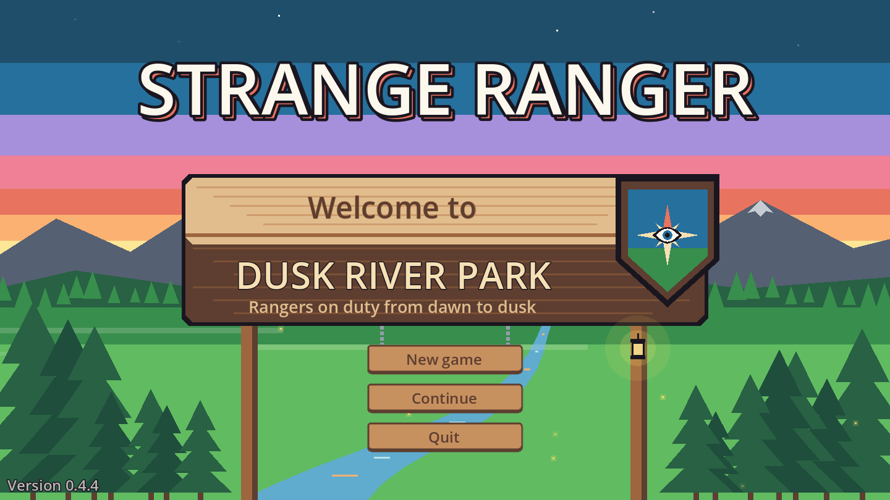
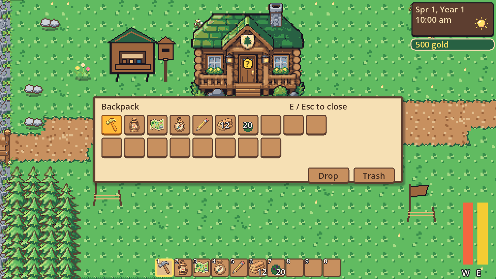
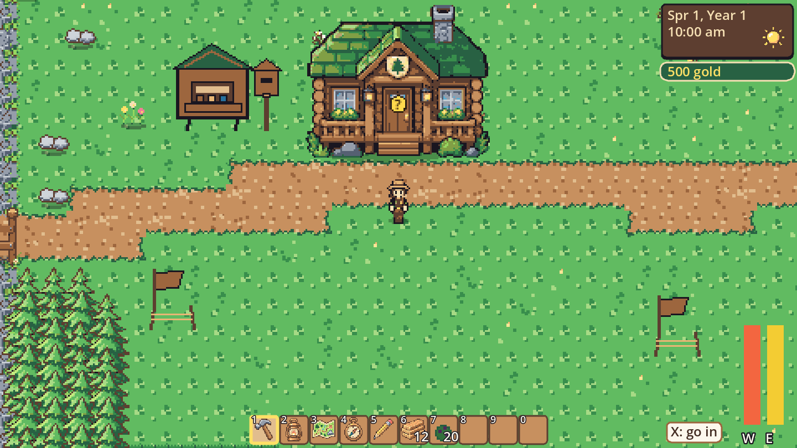
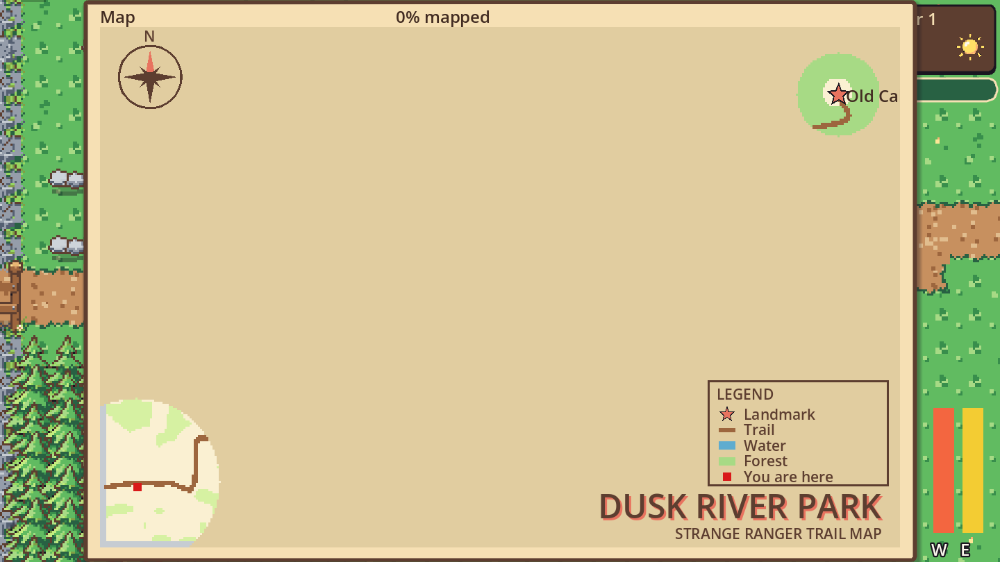
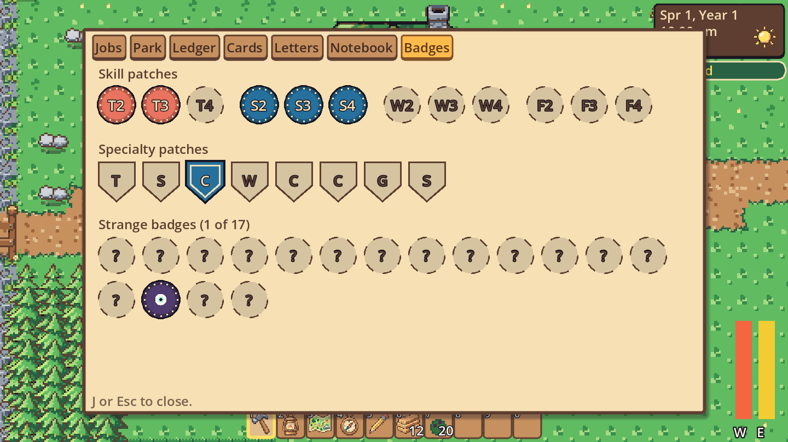

# Strange Ranger: Art Requests 11 to 14, the Park Look

From the lab, 17 November 2026. Four requests for the park poster look in the visual direction brief: the title screen, the ranger's kit for every screen, the poster map's pieces, and the badges. Version 0.4.5 already has all four, drawn in code as stand-ins (the pictures below), so each piece drops in as it arrives and nothing waits.

**The ground rules, from the decisions:**
- Everything is **pixel art at exactly game size**, the same way as Art Requests 03 to 09.
- Use the **bright palette** of Art Request 06. The game keeps its colours; no muting.
- The park is **Dusk River Park**; the game is **Strange Ranger**.
- The emblem is a **compass rose with an eye** at its heart, on a shield. It's our own design: no arrowhead, and not the real park service's name or marks.
- **Strange touches** appear only at night and around magic.

**Style line, at the start of every prompt:**

> True pixel art, crisp hard-edged pixels on an exact grid, every pixel a solid square, no anti-aliasing, no blur, no gradients, warm cozy 16-bit farming game style, bright cheerful palette, mid-century national park poster and scout patch feel, light from the top left.

The lab asks for these one at a time, **11 first**.

---

## Art Request 11: the title screen, the entrance to Dusk River Park

The screen is 480 × 270. The sky's colour bands stay drawn by the game; everything else is art. The layers are wider than the screen because they drift slowly at different speeds.

| # | File | Size | What |
| --- | --- | --- | --- |
| 1 | `ar11_layers.png` | 512 × 480 | Four landscape layers, each 512 × 120, stacked: far mountains with snow on three peaks; a ridge of pines; the river valley meadow with the Dusk River winding toward us; the near pines, left and right edges only, middle transparent |
| 2 | `ar11_sign.png` | 288 × 96 | The routed-wood entrance sign with its two posts (below) |
| 3 | `ar11_emblem.png` | 64 × 72 | The emblem shield on its own, also used on the map and the badges |
| 4 | `ar11_logo.png` | 400 × 64 | "STRANGE RANGER" in big poster letters |
| 5 | `ar11_bits.png` | 96 × 32 | A lantern, 2 frames of 12 × 16; a firefly, 2 frames of 4 × 4; a hanging menu plank, 84 × 15, blank |

**The sign.** It's two-tone routed wood like the reference: a light upper band with "Welcome to" in a friendly script, and a dark lower band with "DUSK RIVER PARK" in cream block capitals. Under that, small, "Rangers on duty from dawn to dusk". The top-right corner is cut on a slant, and the emblem shield overlaps that corner. Two posts go down to the bottom edge. The letters are cut into the wood, so draw them in.

**The emblem.** A shield split into sky (blue) above and forest (green) below. A compass rose sits over both, its north point coral, and an eye with a blue iris is at the rose's centre. Simple enough to read at 24 px tall on the badges.

**Prompt (sign).**

> [Style line]. A 288 by 96 pixel art park entrance sign on a transparent background: a routed two-tone wooden sign, light honey wood upper band reading "Welcome to" in a friendly script, dark walnut lower band reading "DUSK RIVER PARK" in cream block capitals with "Rangers on duty from dawn to dusk" small beneath, the top right corner cut on a slant, two wooden posts going down to the bottom edge, a one-pixel dark outline.

**Prompt (emblem).**

> [Style line]. A 64 by 72 pixel art shield emblem on a transparent background: dark walnut rim, blue sky in the upper half, green forest in the lower half, a cream eight-point compass rose across both with a coral north point, and at the compass's centre a wide-open eye with a blue iris.

**Prompt (layers).**

> [Style line]. Four 512 by 120 pixel art parallax layers stacked in one image, transparent above each skyline: far slate-blue mountains with snow on three peaks; a dark green ridge of pine trees; a bright green meadow valley with a blue river winding from the far middle toward the bottom left, catching orange sunset light; tall dark pines only at the left and right edges.

---

## Art Request 12: the ranger's kit (every screen)

**9-slice pieces.** These are frames the game stretches. Keep the corners and edges inside the margin given, and make the middle plain enough to repeat.

| # | Piece | Size | Margin | What |
| --- | --- | --- | --- | --- |
| 1 | Paper panel | 48 × 48 | 8 | Field-book paper: cream with faint lines, a walnut border, a stitched rule just inside it |
| 2 | Plank button | 32 × 16, 4 states stacked | 4 | A wooden plank: normal, hover (lighter), pressed (darker, pushed in 1 px), disabled (faded) |
| 3 | Book tab | 32 × 16, 2 states | 4 | A cloth tab: the open page's and the others' |
| 4 | Paper tag | 24 × 16 | 5 | A small luggage tag with a string hole on the left, for hover hints |

**Fixed pieces.**

| # | Piece | Size | What |
| --- | --- | --- | --- |
| 5 | Clock sign | 80 × 34 | A small routed-wood sign hanging from two short chains; the date and time are written over it |
| 6 | Wallet patch | 80 × 12 | A green stitched patch with room on the left for the coin from Art Request 10 |
| 7 | Item peg | 18 × 18, 2 states | A wooden peg-board slot; the held one ringed in gold |

All on one sheet, `ar12_kit.png`, each piece in its own cell with a one-pixel gap. The lab cuts it up.

**Prompt.**

> [Style line]. A pixel art user interface kit for a cozy park ranger game, transparent background, each piece separate with space between: a cream field-book paper panel with a walnut border and a stitched inner line, 48 by 48; a wooden plank button in four states stacked, 32 by 16 each; two cloth book tabs, 32 by 16; a small paper luggage tag with a string hole, 24 by 16; a small routed-wood sign hanging on two chains, 80 by 34; a green embroidered patch strip with a cream stitched edge, 80 by 12; two wooden peg-board slots, 18 by 18, the second ringed in gold.

---

## Art Request 13: the poster map's pieces

The map's land stays drawn by the game from what's been surveyed, in flat bright colours: cream meadows, light green forest, blue water, brown trail lines. These pieces dress it as a park poster.

| # | Piece | Size | What |
| --- | --- | --- | --- |
| 1 | Compass rose | 32 × 32 | Eight points, the north one coral, an "N" above |
| 2 | Landmark star | 9 × 9 | The red star for a mapped landmark |
| 3 | Site icons | 12 × 12 each | The station, the old cabin, the fire tower, the outlook, the pond: tiny pictograms in the poster style |
| 4 | Legend frame | 9-slice 32 × 32, margin 6 | A poster's legend box |
| 5 | Unexplored paper | 64 × 64, tiles seamlessly | Parchment with faint topographic contour lines, for land not yet surveyed |
| 6 | Park name | 200 × 24 | "DUSK RIVER PARK" in the poster's lettering, with a coral shadow |

On one sheet, `ar13_map.png`.

**Prompt.**

> [Style line]. Pixel art pieces for a vintage national park poster style trail map, transparent background, each separate: a 32 by 32 eight-point compass rose with a coral north point and an "N"; a 9 by 9 red star; five 12 by 12 pictograms (a log ranger station, a small cabin, a fire lookout tower, a scenic overlook with binoculars, a pond); a 32 by 32 legend box frame; a 64 by 64 seamless tile of cream parchment with faint brown topographic contour lines; the words "DUSK RIVER PARK" in bold condensed poster letters with a coral drop shadow, 200 by 24.

---

## Art Request 14: the badges

The book has a new Badges page. Every patch is 24 × 24, round, embroidered, with a twisted-cord edge like the scout patch references.

| # | What | Count | Notes |
| --- | --- | --- | --- |
| 1 | Skill patches | 12 | Four skills, three levels each (2, 3, 4). Trailcraft: a shovel and trail; Surveying: a map and compass; Woodcraft: an axe and saw; Foraging: a mushroom and berries. The level shows as one, two or three stitched stars under the picture. One colour per skill: coral, blue, green, pink. |
| 2 | Specialty shields | 8 | Shield-shaped, 24 × 26, two for each skill, in that skill's colour. Trail builder, Sawyer, Cartographer, Wayfinder, Carpenter, Camp hand, Gatherer, Seeker. |
| 3 | Strange badges | 17 | Deep violet with a glowing mint thread, each with its own odd little picture: an eye, a moth, a keyhole, a crescent, a hand, a spiral. They're the weird merit badges of the references, but cosy-eerie, never gory. **Which badge goes with which find stays the lab's**, so just draw 17 different ones. |
| 4 | Locked patch | 1 | The empty outline a patch shows before it's earned: a dashed stitch circle on bare cloth. |

On one sheet, `ar14_badges.png`, as a grid of 24 × 24 cells (shields in 24 × 26 cells), one-pixel gaps.

**Prompt.**

> [Style line]. A sheet of 24 by 24 pixel art embroidered merit badge patches for a park ranger game, transparent background, round with a twisted cord edge: twelve skill patches in four colours (coral with a shovel, blue with a map and compass, green with an axe and saw, pink with a mushroom and berries), each colour three times with one, two or three small stitched stars; eight small shield-shaped patches, two in each colour; seventeen deep violet patches with glowing mint thread showing odd cosy-eerie pictures (an eye, a moth, a keyhole, a crescent moon, an open hand, a spiral, and so on); one empty dashed-stitch circle.

---

## What the lab does with each

- **11:** the sign, layers, logo and emblem replace the drawn title. The emblem is reused on the map and the Badges page.
- **12:** the frames replace the plain style boxes in `scripts/ui/kit_style.gd`, so every screen changes at once.
- **13:** the pieces replace the drawn compass, stars and lettering. The paper tile goes under unexplored land.
- **14:** the patches replace the drawn circles on the Badges page.
